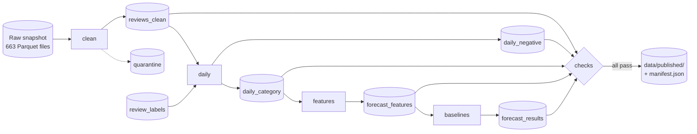

# SteamPulse

SteamPulse finds complaint types that are picking up in Steam reviews and forecasts whether they'll keep growing over the next week.
Steam reviews are full of player feedback, but a rising problem is easy to miss. SteamPulse sorts negative reviews into complaint categories such as crashes, performance, matchmaking/server, and monetization, and tracks each category's daily share of negative reviews for selected games.

A category is flagged as **emerging** when its share over the last 7 days beats its share over the previous 28 days by a set threshold. Minimum-volume checks keep small samples from setting off false alarms. A Spark ML model then uses recent volumes and trends to predict each category's share for the next 7 days. We compare it against simple baselines using chronological train/validation/test splits.

The trained model is served through a FastAPI service. In the Streamlit dashboard, you pick a game and a date and see observed and predicted growth, with review excerpts as evidence.

SteamPulse is meant to help teams decide which issues are worth looking into. It doesn't identify root causes, judge technical severity, or set fix priorities.

## Scope

- **Data:** the public Steam reviews snapshot on Hugging Face ([`adde023/steam-reviews`](https://huggingface.co/datasets/adde023/steam-reviews)), processed in batch with Spark. Modeling uses English negative reviews for one to five games.
- **Complaint categories:** `crash`, `performance`, `match_server`, `monetization` (multi-label). Negative reviews that match none of these are kept as unclassified.
- **Product:** batch data pipeline, rule-based emerging-issue detection, seven-day share forecast (Spark ML + MLflow), FastAPI service, and a Streamlit historical replay.

## Data source

The [Steam Reviews dataset](https://www.kaggle.com/datasets/kieranpoc/steam-reviews) by kieranpoc on Kaggle, used through its Parquet conversion on Hugging Face ([`adde023/steam-reviews`](https://huggingface.co/datasets/adde023/steam-reviews), snapshot `d0ec12b`). Licensed under [CC BY-NC 4.0](https://creativecommons.org/licenses/by-nc/4.0/): non-commercial use with attribution.

We filter, clean and aggregate the data; the raw files are not redistributed in this repository. Review excerpts are shown briefly and without user identifiers.

## Team

| Member | Role | Responsibilities |
|---|---|---|
| [Isabella Shi](https://github.com/isabellaywshi) | Data engineering | Data profiling and cleaning, daily tables, features, baselines, quality checks, pipeline orchestration |
| [Yifan Huang](https://github.com/Sue1996-bits)| Analysis / ML | Complaint taxonomy, labeling rules, alerts, model training and evaluation, MLflow tracking |
| [Yunseo Oh](https://github.com/yunseoyunnieoh) | Application | API design, model serving, Streamlit dashboard, integration, demo |

## Setup

These steps go from a fresh clone to published tables. Run `make help` to list every command.

### 1. Install

Requirements: [uv](https://docs.astral.sh/uv/), `make`, and Java 17.

```bash
# macOS: install Java 17 once, then make it the default
brew install openjdk@17
echo 'export JAVA_HOME="$(brew --prefix openjdk@17)/libexec/openjdk.jdk/Contents/Home"' >> ~/.zshrc
echo 'export PATH="$JAVA_HOME/bin:$PATH"' >> ~/.zshrc
source ~/.zshrc

git clone https://github.com/Sue1996-bits/SteamPulse.git
cd SteamPulse
make setup   # checks Java, creates .venv from uv.lock
make test
```

### 2. Get the data and profile it

The raw snapshot goes in `data/raw/`, which Git ignores. Downloads are pinned to the snapshot hash in `pipeline/config.py`, and files already downloaded are skipped.

```bash
make download-sample   # first 2 part files (~65 MB), for a quick benchmark
make download          # all 663 part files (~23.5 GB)
make profile           # per-game profile -> data/profile/
make select-games      # rank candidate games on the training period -> data/profile/candidates.csv
```

### 3. Run the pipeline

One command runs every step in order and then the quality checks:

```bash
make pipeline                                       # clean -> daily -> checks
make pipeline LABELS=path LABEL_VERSION=v           # + daily_category, features, baselines
make pipeline LABELS=path LABEL_VERSION=v PUBLISH=1 # and publish if every check passes
```

Add `LOG=1` to a measured run to append its timings to `docs/scale_log.md`. Each step also has its own command:

```bash
make clean-reviews     # reviews_clean for the chosen games -> data/staging/reviews_clean/
make label-sample      # hand-labeling sample -> data/samples/
make daily             # daily_negative (+ daily_category with LABELS=path LABEL_VERSION=v)
make features LABEL_VERSION=v   # forecast_features + feature_manifest.json
make baselines         # persistence and rolling-28 forecasts + MAE
make checks            # quality checks on data/staging/
make publish           # checks, then copy to data/published/ with manifest.json
```

### 4. Check the outputs

`make checks` writes `data/staging/check_report.json`, and `make publish` copies the tables to `data/published/` only if every check passes. To rewrite the manifest for what's already published:

```bash
make manifest   # writes data/published/manifest.json
```

The manifest is generated, never hand-edited. It records the dataset snapshot, cohort/label/feature versions, code commit, `uv.lock` hash, runtime versions, and row/file counts for every published table.
## Pipeline



Every step reads and writes Parquet under `data/` (ignored by Git), partitioned by `app_id`. Column lists and keys for each table are in `pipeline/config.py`.

| Table | One row per | What it holds |
|---|---|---|
| `reviews_clean` | review | Unedited reviews in the analysis window for the chosen games, every language and both vote directions. String IDs, UTC timestamps, raw and normalized text. |
| `review_labels` | review and category | Complaint labels from the labeling rules. A negative review with no label still counts as unclassified. |
| `daily_negative` | game and day | English negative reviews per UTC day, and whether the day is `covered` or a `gap` (null counts). |
| `daily_category` | game, day and category | Category count, total negatives and their share for each day. |
| `forecast_features` | game, day and category | Features using only data up to that day, the next-7-day target in its own column, and an eligibility flag. |
| `forecast_results` | game, day, category and method | Observed status (`emerging`, `not_flagged`, `insufficient_data`) and the next-week forecast. |

How dates, the strict cohort and gap days are handled is in [`docs/temporal_policy.md`](docs/temporal_policy.md). Run sizes and timings are in [`docs/scale_log.md`](docs/scale_log.md).

### Data quality

The clean step accounts for every raw row of the five chosen games (counts in `data/staging/clean_summary.json`):

| | Rows |
|---|---|
| Raw rows for the five games | 2,864,373 |
| Created outside Nov 2022 to Oct 2023 | 2,240,404 |
| Edited after posting (outside the strict cohort) | 48,073 |
| Empty text (quarantined) | 1,934 |
| Missing or invalid IDs, timestamps or votes | 0 |
| Duplicate review IDs | 0 |
| **Kept in `reviews_clean`** | **573,962** |
| English negative reviews among them | 60,037 |

Every game has reviews on all 365 days of the window, so there are no gap days. Dropping edited reviews removes 14-19% of each game's English negatives in the training period, and it removes more of the older reviews than the newer ones. `docs/temporal_policy.md` describes this bias.

`make checks` tests every table for schema, unique keys, allowed values, shares between 0 and 1, gap days kept as nulls, a complete day grid, no feature dates after the as-of date, and row counts that match `clean_summary.json`.
