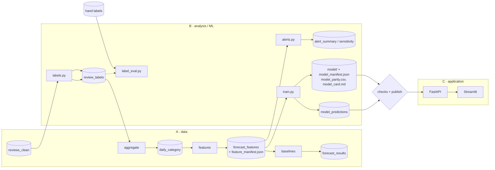

# SteamPulse · Analysis and ML (role B)

Design, process and module reference for the analysis/ML workstream. Owner: Yifan Huang (B). Reviewers: Isabella Shi (A, data), Yunseo Oh (C, application).

Status: code complete and tested on the shared fixture and a synthetic year, and the bundle has been served through C's API. **Not yet done:** tuning the rules on real hand labels, the real training run, and the one-time test scoring. Every number in this document is a definition or a setting, not a result.

---

## 1. Scope

B owns the steps between clean reviews and a deployable model (project plan §8):

| B owns | B relies on | B hands over |
|---|---|---|
| Complaint taxonomy, labeling rules, annotation guide | `reviews_clean` (A) | `review_labels` → A's daily tables |
| Rule evaluation against hand labels | label sample (A's `label_sample.py`) | precision/recall/F1 tables, error lists |
| Alert analysis (thresholds, follow-through) | `forecast_features` (A), `observed_status` rule (A) | alert tables, frozen thresholds |
| Split design, model fitting, MLflow, evaluation | `forecast_features`, `feature_manifest.json` (A) | model bundle → C's API |
| Model card, scoring specification, error analysis | | report sections: related work, experimental design, results |

B does not change how A counts reviews or builds features, and does not change C's API. Where B needed a shared file changed (config, checks, runner), the change is additive and goes through A's review.

## 2. Design process

The work went in the order of the data, and every step was checked against the next team member's code before moving on.

**2.1 Start from the contracts.** Before writing anything, I read `pipeline/config.py` (schema v1), the shared fixture in `tests/fixtures/`, A's `aggregate.py` and `features.py`, and C's `application/api.py`, `published.py` and README. That fixed the interfaces up front: `review_labels` must have the columns in `REVIEW_LABELS_COLS` and be readable by `aggregate.read_labels`; the model must be a Spark `PipelineModel` per category that reads the 19 `FEATURE_COLS` in manifest order and writes `prediction`, described by a `model_manifest.json` that C's `Publication` class validates.

**2.2 Rules before a classifier.** The plan's version 1 is keyword rules, for three reasons: we have no labels yet, rules are explainable (every label stores the rule and the matched words), and they're cheap to rerun over 60,000 negatives in Spark. Negation is handled by blanking "negator + up to three words + term" before matching, only for event terms (crash, lag, pay to win). Complaints that are still complaints when negated ("not optimized", "won't launch") are not negatable. A TF-IDF classifier stays optional, after the core path works.

**2.3 Measure the rules honestly.** Rules are written against 300 training-period reviews and checked once on 150 later reviews that weren't used for editing. Annotator agreement (Cohen's kappa) is measured on double-labeled reviews before rules are scored, so we know how much disagreement is in the yardstick itself.

**2.4 Reuse the alert rule; study it instead of rewriting it.** A already implements the observed status (`baselines.observed_status`). Rather than a second implementation, `alerts.py` counts the same alerts (a test proves the counts match), varies the thresholds on validation only, and follows each alert one week ahead. That last part is the analysis the plan proposes as our contribution (§17).

**2.5 Splits by target week.** A forecast at t uses days ≤ t and is scored on t+1..t+7, so a row belongs to the split containing its whole target week. The week before each boundary is purged. One shared function (`splits.py`) is used by training and alerts.

**2.6 A small, honest model.** One GBT regressor per category, pooled across games, because about 855 training rows per category can't support per-game models. A small grid is searched on validation, the winner is compared with both baselines on identical rows, then refit on train + validation. The trained model is deployed even if a baseline wins validation (the plan requires genuine model deployment); `validation_winner` records which method won.

The first version (`gbt_v1`) predicted the share directly, and on validation it lost to the rolling 28-day baseline in every category. Two reasons showed up in the per-game scores. Trees can't extrapolate: Destiny 2's monetization share rose in the validation period far above anything seen in training, and a tree can only predict values within the range it was trained on. And approximating the near-linear link between the next week's share and the recent shares with a few splits adds error of its own. The current version (`gbt_v2`) therefore learns only the correction to the rolling 28-day share: `prediction = share_28d + shrinkage × GBT(target_share_next7 − share_28d)`. The baseline supplies the level, the trees model the deviation, and when the trees learn nothing the prediction falls back to the baseline. The shrinkage is chosen on validation from {0.25, 0.5, 1}; 0 is left out so a learned component is always deployed. `--target level` still trains `gbt_v1`, so both can be scored on the same test rows.

**2.7 Package for serving.** The imputer goes inside each saved pipeline, so C never re-implements a transform. The manifest carries versions, feature order and types, the cutoff, and a parity file with a declared tolerance. Predictions are published only for dates on or after `training_label_end`, the same rule C's API enforces with a 503.

**2.8 Verify across the boundaries.** Unit tests cover each function; handoff tests run A's `aggregate` on B's labels and rebuild single rows the way C's API does; a synthetic year runs every command end to end; and an integration test starts C's actual API on B's bundle (it skips until C's `application/` is merged, then runs automatically).

### Decision log

| Decision | Alternatives | Why |
|---|---|---|
| Keyword rules with evidence (`rules_v1`, then `rules_v2`) | TF-IDF + logistic regression; LLM labeling | No labels yet; explainable; paid APIs and LLMs are out of scope |
| Plain "lag" → `match_server`; "input lag" → `performance` | Leave "lag" unlabeled | These are online shooters; checked against hand labels and revisable |
| `review_labels` partitioned by `label_version` | One folder per run | Versions sit side by side; a rerun replaces only its own version |
| Split by target week, purge 7 days | Split by row date | Prevents target windows crossing splits (plan §7) |
| `VAL_END = 2023-08-15` | 2023-08-31 | Gives about 55/22/23% of eligible origins, close to the planned 60/20/20 |
| GBT per category, pooled across games | Per-game models; one multi-output model | Enough rows per model; one model per category is what the API loads |
| Learn the correction to `share_28d` (`gbt_v2`) | Predict the share directly (`gbt_v1`) | Trees can't follow a level never seen in training; the correction keeps the baseline's level and falls back to it. `gbt_v1` stays reproducible for comparison |
| Refit on train + validation for deployment | Deploy the train-only model | Uses all labeled history before test; test stays untouched |
| Model predictions only from `training_label_end` | Predict every date | A replay must not use a model trained on its own future |
| Test scored only with `--score-test` | Always score | Makes "look at test once" a deliberate step |

## 3. Data flow



## 4. Modules

All modules follow the repository's pattern: a docstring with usage at the top, pure functions on DataFrames (testable), and a `main()` that reads from and writes to `data/staging/`. Nothing reaches `data/published/` without passing `make checks`.

### 4.1 `pipeline/labels.py` — rule labels

| | |
|---|---|
| Purpose | Assign the four complaint categories to every English negative review |
| Input | `data/staging/reviews_clean` (`review_id`, `text_normalized`, `language`, `voted_up`) |
| Output | `data/staging/review_labels/label_version=<v>/` and `label_coverage_<v>.csv` |
| Key functions | `RULES` (ordered `(rule_id, pattern, negatable)` per category), `negation_pattern()`, `match_category()`, `label_reviews()`, `coverage()` |
| Command | `make labels [LABEL_VERSION=rules_v2] [APPS="..."]`; also run by `make pipeline LABEL_VERSION=...` |
| Tests | `tests/test_labels.py`: 27 example sentences, schema, rule IDs, B→A handoff into `daily_category`, review_labels checks, coverage |

Rules (rules_v2):

| Category | Rule IDs (match order) | Negatable |
|---|---|---|
| `crash` | `crash_word`, `crash_desktop`, `crash_freeze`, `crash_launch` | all but `crash_launch` |
| `performance` | `perf_fps`, `perf_stutter`, `perf_optimization`, `perf_bad`, `perf_loading`, `perf_resources` | `perf_fps`, `perf_stutter` |
| `match_server` | `server_matchmaking`, `server_queue`, `server_disconnect`, `server_quality`, `server_lag` | `server_disconnect`, `server_lag` |
| `monetization` | `money_mtx`, `money_p2w`, `money_greed`, `money_price`, `money_store` | `money_mtx`, `money_p2w`, `money_store` |

The first matching rule gives `rule_id`; the matched text (up to 120 characters) is the `evidence`. Any rule change requires bumping `LABEL_VERSION` in `config.py`.

Rule versions:

| Version | Change | Evidence |
|---|---|---|
| `rules_v1` | First keyword rules | Unit examples only |
| `rules_v2` | `perf_fps` no longer matches "fps" on its own. It needs a frame-rate context: a number ("40fps"), "fps drops", "low fps", "my fps", or "frame rate" | Spot check on the real English negatives: in many reviews "fps" names the genre (first-person shooter). The stricter rule removed 463 of 865 matches; most removed matches in a random sample were genre uses |

### 4.2 `pipeline/label_eval.py` — rules vs hand labels

| | |
|---|---|
| Purpose | Measure rule quality and annotator agreement; produce the committed gold file |
| Input | Filled label-sample CSVs (1/0 in each category column; incomplete rows are skipped), `reviews_clean` for text |
| Output | `data/staging/label_eval_<v>_<period>.csv`; `data/samples/label_errors_<v>_<period>.csv`; `data/samples/disagreements_<a>_<b>.csv`; `labels/<name>.csv` (IDs and labels only) |
| Subcommands | `score GOLD [--period train\|later]`, `agree A B`, `export GOLD` |
| Command | `make label-eval GOLD=... [PERIOD=later]` |
| Tests | `tests/test_label_eval.py`: partial files, invalid cells, spreadsheet byte-order mark, metrics and kappa by hand, rules scored on their own examples |

### 4.3 `pipeline/splits.py` — chronological splits

`split_col()` assigns `train` / `validation` / `test` / `purged` by target week. `usable()` selects eligible rows with a target. `row_status()` names why a row is excluded (`insufficient_history`, `gap_in_window`, `low_volume`, `no_target`). Used by `train.py` and `alerts.py`; boundary dates are tested in `tests/test_train.py`.

| Split | Forecast origins (t) | Target weeks end by |
|---|---|---|
| train | 2022-12-05 to 2023-05-24 | 2023-05-31 (`TRAIN_END`) |
| purged | 2023-05-25 to 2023-05-31 | — |
| validation | 2023-06-01 to 2023-08-08 | 2023-08-15 (`VAL_END`) |
| purged | 2023-08-09 to 2023-08-15 | — |
| test | 2023-08-16 to 2023-10-24 (scored) | 2023-10-31 (`WINDOW_END`) |

The first origin is 2022-12-05 because 35 days of history are needed. With five games that's about 855 / 345 / 350 scored rows per category, before low-volume exclusions.

### 4.4 `pipeline/alerts.py` — alert analysis

| | |
|---|---|
| Purpose | Count alerts, choose thresholds on validation, and test whether alerts are followed by a raised share |
| Input | `forecast_features` (eligible rows with a target) |
| Output | `alert_summary.csv` (per split, game, category at configured thresholds); `alert_sensitivity.csv` (validation, grid of `MIN_LIFT` {0.03, 0.05, 0.08, 0.10} × `MIN_C7` {5, 10, 20} × `MIN_N7` {50, 100}) |
| Command | `make alerts [TEST=1]` (test only once thresholds are frozen) |
| Tests | `tests/test_alerts.py`: counts equal `observed_status == emerging` from A's baselines, measures by hand, grid contains the configured rule, test excluded by default |

### 4.5 `pipeline/train.py` — forecast model

| | |
|---|---|
| Purpose | Fit, select, compare, refit, export and log the seven-day share model |
| Input | `forecast_features` and `feature_manifest.json` for one `label_version` |
| Model | Per category: `Imputer(median)` → `VectorAssembler` → `GBTRegressor` on `target_share_next7 − share_28d` → `SQLTransformer` writing `prediction = share_28d + shrinkage × correction`. Grid `maxDepth` {2, 3, 4} × `maxIter` {20, 50} × shrinkage {0.25, 0.5, 1}, `stepSize` 0.1, seed 226. `--target level` trains `gbt_v1` (direct share) for comparison |
| Output | `model/<category>/`, `model_manifest.json`, `model_predictions/`, `model_parity.csv`, `model_scores.csv`, `model_row_counts.csv`, `model_errors.csv`, `model_feature_importance.csv`, `model_card.md`; MLflow run in `mlruns/` |
| Command | `make train [LABEL_VERSION=...] [TEST=1]`, `make mlflow-ui`; comparison: `python -m pipeline.train --target level --out-dir data/staging/compare_gbt_v1` |
| Tests | `tests/test_train.py`: split boundaries, no crossing target weeks, manifest = API contract, identical scoring rows, exclusions add up, errors and card, cutoff-safe predictions, bundle checks, parity, MLflow runs, C's API end to end |

MLflow layout: one parent run per training (versions, splits, grid, commit; validation MAE per category and method; macro MAE; all output files and the models as artifacts), and one nested run per category × grid setting (`val_mae_pp`).

### 4.6 Changes to shared files

| File | Change | Reviewer |
|---|---|---|
| `pipeline/config.py` | `LABEL_VERSION = "rules_v2"`, `VAL_END = "2023-08-15"`, `MODEL_VERSION = "gbt_v2"` | A |
| `pipeline/checks.py` | Checks for `review_labels` (categories, evidence, only English negatives), `model_predictions` (incl. no prediction before `training_label_end`) and the model bundle (format, feature order, versions match `feature_manifest.json`, model folders present, predictions from this model); publishes `model/` and B's CSV/markdown outputs | A |
| `pipeline/run.py` | `--label-version` without `--labels` runs `labels` before `daily` and logs it to the scale log | A |
| `Makefile`, `README.md` | `labels`, `label-eval`, `alerts`, `train`, `mlflow-ui`; README sections for labels and the model | A |
| `pyproject.toml`, `uv.lock` | `mlflow>=2.16,<3` (resolves to 2.22.5; numpy, pandas, pyarrow and pyspark pins unchanged) | A, C |

## 5. Interfaces

### 5.1 B → A: `review_labels`

Columns `review_id, category, is_match, rule_id, evidence, label_version`; key `review_id + category + label_version`. One row per assigned label, `is_match` always true; a missing row means "not assigned", and the review still counts in `negative_total`. Only English negatives are labeled. `aggregate.read_labels` reads the partitioned folder and filters by version; a test checks that the denominator doesn't change.

### 5.2 A → B: what training relies on

`forecast_features` with `FEATURE_COLS` (19, fixed order), `eligibility`, `target_share_next7` and `target_n_next7`; `feature_manifest.json` with the same order, types and `label_version`. `train.main` refuses to run if the manifest's feature list or label version differs.

### 5.3 B → C: model bundle

Directory layout inside a publication: `model_manifest.json` at the root, models at `model/<category>/`.

| Field | Meaning | Checked by |
|---|---|---|
| `format` | `"spark_pipeline"` | C `Publication`, `checks` |
| `model_version` | `gbt_v2`; also `method_version` of model rows | C response |
| `target` | the formula the model implements (`share_28d + shrinkage * GBT(target_share_next7 - share_28d)`) | report |
| `training_label_end`, `replay_start` | last target day seen by the deployed model; first allowed replay date | C returns 503 before it; `checks` on predictions |
| `feature_version`, `label_version`, `snapshot_id` | must equal `feature_manifest.json` | C `Publication`, `checks` |
| `features`, `feature_types` | ordered names and Spark types | C builds the input row from them |
| `prediction_column`, `prediction_clip` | `prediction`, [0, 1] | C clips |
| `categories.<c>` | `path`, chosen `params` and `shrinkage`, `fit_rows`, `val_mae_pp` per method, `validation_winner` | C loads `path` |
| `validation_winner` | best method per category on validation | C may enable `best_validation` |
| `parity` | `model_parity.csv` and tolerance 1e-9 | C's parity check |
| `seed`, `mlflow_run_id`, `code`, `cohort_*`, `splits`, `created_at` | reproducibility | report |

`model_parity.csv` lists, for each game, the first, middle and last forecastable date on or after `replay_start`, all four categories, with the offline prediction. C's API must return the same value within the tolerance; the integration test checks exactly this.

## 6. Scoring specification

### 6.1 Labels

Per category on hand-labeled reviews: support (gold positives), predicted, TP, FP, FN, precision = TP/(TP+FP), recall = TP/(TP+FN), F1. Empty denominators give null, not 0. The `any` row compares "at least one category" against unclassified. The `train` period is for development; the `later` period is scored once, after the rules are frozen. A keyword-enriched sample, if used, is reported separately and never as a population estimate. Agreement: percent agreement and Cohen's kappa per category, on reviews both annotators labeled.

### 6.2 Alerts

An alert is an eligible row with `c_7d >= MIN_C7` and `lift_pp >= 100 × MIN_LIFT`. For eligible rows with a target: `next_change_pp = 100 × (target_share_next7 − share_7d)` and `stays_elevated = target_share_next7 − baseline_share >= MIN_LIFT`. Both are reported after an alert and without one. No accuracy is claimed for alerts, since there are no independent event labels; these are descriptive measures.

### 6.3 Forecasts

- Error: absolute error in percentage points, `100 × |clip(pred, 0, 1) − target_share_next7|`, for the model and both baselines (persistence = `share_7d`, rolling-28 = `share_28d`).
- Rows: eligible with a target, in the split. All methods are scored on exactly the same rows.
- Aggregates (`model_scores.csv`): per split × category × game and pooled (`app_id = all`); `mae_pp` (unweighted) and `mae_pp_weighted` (weighted by the target week's negative count), reported separately; `category = macro` is the mean of the four pooled categories.
- Exclusions (`model_row_counts.csv`): `insufficient_history`, `gap_in_window`, `low_volume` and `no_target` are counted per split and category, never silently dropped.
- Interpretation: daily seven-day targets overlap, so daily errors aren't independent. No significance tests or confidence intervals.

## 7. Leakage and temporal safety

| Risk | Control | Where |
|---|---|---|
| Edited text written after the review date | Strict unedited cohort | A `clean.py` |
| Features after t | Windows end at t; `feature_max_date <= as_of_date` check | A `features.py`, `checks.py` |
| Target weeks crossing splits | Split by target week; 7-day purge | `splits.py`, test |
| Tuning on test | Grid and thresholds chosen on validation; test only with `--score-test` / `--include-test` | `train.py`, `alerts.py` |
| Imputer fitted on future rows | Imputer inside each pipeline, fitted on that model's training rows | `train.py` |
| Model trained on a replay's future | Predictions only from `training_label_end`; API 503 before it; check | `train.py`, C API, `checks.py` |
| Rules tuned on the held-out labels | Rules edited on `train` only; `later` scored once; version bump if changed | `label_eval.py`, guide |
| Game choice using later data | Games chosen on the training period only | A `select_games.py` |

## 8. Reproducibility and runbook

From a fresh clone (Java 17, uv, make):

```bash
make setup && make test
# reviews_clean is needed: either the full download (~23.5 GB) and clean,
make download && make clean-reviews
# ...or copy A's data/staging/reviews_clean (~0.1 GB) into data/staging/.

make pipeline LABEL_VERSION=rules_v2            # labels -> daily -> features -> baselines -> checks
make alerts LABEL_VERSION=rules_v2
make train LABEL_VERSION=rules_v2               # validation only
make publish                                    # checks, then data/published/
STEAMPULSE_DATA_DIR=data/published ...          # C's API (application/README.md)

# Labels
make label-sample APPS="1172470 1517290 1811260 1085660 359550"
python -m pipeline.label_eval agree data/samples/label_sample_226_<a>.csv data/samples/label_sample_226_<b>.csv
make label-eval GOLD=data/samples/label_gold_226.csv
python -m pipeline.label_eval export data/samples/label_gold_226.csv

# Once, at the end, after every choice is frozen
make label-eval GOLD=data/samples/label_gold_226.csv PERIOD=later
make alerts TEST=1 && make train TEST=1
python -m pipeline.train --target level --score-test --out-dir data/staging/compare_gbt_v1   # gbt_v1 on the same rows
```

Every output is tied to `snapshot_id`, `cohort_version`, `label_version`, `feature_version`, `model_version`, the git commit and the MLflow run ID. Reruns with the same versions replace their partitions instead of appending.

## 9. Requirements traceability

| Requirement | Source | Where | Status |
|---|---|---|---|
| ML model building | Guidelines | `train.py` | Code done; real run pending |
| Reproducibility with pipeline technology (MLflow) | Guidelines | `train.py` MLflow, manifest versions | Done |
| Model deployment | Guidelines, plan §10 | bundle + C's API; parity and integration tests | Done (synthetic); repeat on real data |
| Original analysis | Guidelines, plan §17 | `alerts.py` follow-through; category-share forecasts; `related_work.md` | Code done; Kaggle check open |
| Taxonomy, annotation guide | Plan §4 | `labeling_guide.md` | Done |
| 300 dev + 150 held-out, ≥20% double-labeled | Plan §4 | `label_sample.py` (A), guide (30%), `label_eval.py` | Tooling done; labeling pending |
| Versioned rules with evidence | Plan §4 | `labels.py` | Done |
| Per-category P/R/F1/support, coverage, disagreement examples | Plan §4, §14 | `label_eval.py`, `label_coverage_*.csv` | Tooling done |
| Thresholds tuned on validation, then frozen | Plan §5 | `alert_sensitivity.csv` | Tooling done |
| Alert counts and sensitivity | Plan §7 | `alerts.py` | Done |
| GBT per category, pooled; small validation search | Plan §6 | `train.py` | Done |
| Both baselines on identical chronological rows | Plan §6, §7, §14 | `model_scores.csv` | Done |
| Bundle: features, order, types, transforms, cutoff, versions, seed, params, code, clipping | Plan §6 | `model_manifest.json`, `model/` | Done |
| Purged boundaries | Plan §7 | `splits.py` | Done |
| MAE by game/category and overall; macro and weighted separately; exclusions | Plan §7 | `model_scores.csv`, `model_row_counts.csv` | Done |
| Trained model served even if a baseline wins | Plan §6, §13 | manifest `validation_winner`; API default | Done |
| Model card, scoring spec, error analysis | Plan §8 | `model_card.md`, §6 here, `model_errors.csv`, `label_errors_*.csv` | Done (generated) |
| B→A handoff: no duplicate rows, denominator unchanged | Plan §8 | `test_labels.py`, `checks.py` | Done |
| B→C handoff: same prediction offline and via API | Plan §8, §12 | `model_parity.csv`, `test_train.py` | Done |
| Temporal safety | Plan §12 | §7 here, tests | Done |
| Collaboration in the repository | Guidelines, plan §18 | five PRs, reviews of A's and C's PRs | In progress |
| Report: related work, experimental design, results | Plan §19 | `related_work.md`, §2 and §6 here, generated tables | Results pending |

## 10. Testing and verification

| Test file | Tests | Covers |
|---|---|---|
| `tests/test_labels.py` | 34 | rules, negation, schema, coverage, handoff to `aggregate`, label checks |
| `tests/test_label_eval.py` | 6 | reading hand labels, metrics, kappa, error lists |
| `tests/test_train.py` | 13 | splits, bundle, scores, exclusions, card, checks, parity, residual add-back, `gbt_v1` reproduction, MLflow, C's API (skips without `application/`) |
| `tests/test_alerts.py` | 4 | consistency with `observed_status`, measures, grid |

The full suite (A's tests included) passes. Beyond the unit tests, a synthetic year (two games, about 65,000 reviews) was run through every command (labels → aggregate → features → baselines → alerts → train → checks → publish), all checks passed, and C's API served the bundle: health reported the model, all three methods responded, dates before the cutoff returned 503, evidence excerpts were returned, and API predictions matched `model_parity.csv` exactly. Synthetic numbers are not results and aren't reported.

## 11. Limitations and open items

- **Rules aren't tuned on real reviews yet.** Their precision and recall are unknown until the hand labels are in. Expect `rules_v2`.
- **Label noise carries into targets.** The forecast predicts rule-labeled shares, not true complaint shares.
- **Strict cohort bias.** Dropping edited reviews removes more older reviews (`temporal_policy.md`).
- **Small sample of games and time.** Five games, one year; pooled models may not transfer.
- **Overlapping targets.** No significance claims; results are point estimates on one test period.
- **Originality check incomplete.** Kaggle notebooks on the dataset still need a manual check (`related_work.md`).
- **Runtime.** Training took about 3 minutes for two synthetic games on 8 cores; five games will take longer, so measure it on the demo machine.
